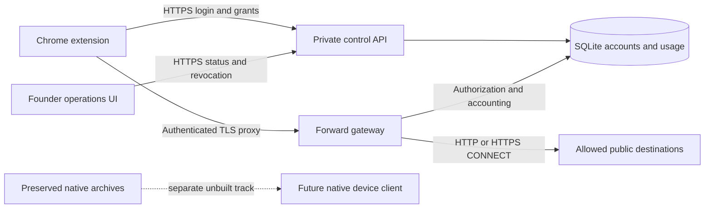

# Project handoff: features, file guide and implementation tasks

Updated: **17 November 2026**. Source baseline reviewed: **`86792c239716824eb32d94d67a355c1fbac13924`**. This document is the root continuation guide for implementation tools and PR reviewers. It describes source that exists, evidence that has been recorded, and work still to do. Check the current commit and [status](docs/STATUS.md) before starting; future PRs must update the relevant entries here.

## Start here

1. Read [AGENTS.md](AGENTS.md), this document, [PROJECT_IDEA.txt](PROJECT_IDEA.txt) and [docs/STATUS.md](docs/STATUS.md).
2. Inspect the current source, Git status, remote `main`, recent commits and open PRs. Preserve other work. Use the existing isolated checkout; do not create a Git worktree unless the owner requests one.
3. Select **one task ID** below. Confirm its prerequisites and read the component's operational documents. The backlog is a plan, not authorization to spend money, publish, provision infrastructure or merge PRs.
4. Implement the smallest complete result on a task branch, run its acceptance checks, update evidence, push and open a PR against `main`.
5. Share the PR URL with the owner/reviewer. Follow the [review process](#pull-request-handoff-and-review-process). Do not silently turn a blocked prerequisite or skipped test into completion.

**Good next engineering task:** T03, the Linux native build audit, can begin with the preserved local sources. T01 is the first browser acceptance priority when an authorized extension-capable runner is available. T24 is a concrete dashboard discrepancy to reproduce and fix; T02 and T13 provide additional local work when external prerequisites are unavailable. The foundational browser build/test/package workflow is already implemented and validated; do not rebuild it from scratch.

## Main goal and present scope

Build an independent, trustworthy privacy/connectivity product with original branding, owner-controlled accounts, understandable protection boundaries, maintained clients and authorized infrastructure. Prove a private owner pilot before serving customers. Expansion depends on measured reliability, security, maintainers and sustainable costs; the horizons in PROJECT_IDEA.txt are estimates, not deadlines.

There are **two distinct product tracks**:

| Track | Present state | Goal and completion boundary |
| --- | --- | --- |
| Chrome browser proxy | Implemented private prototype with local validation | Prove actual extension routing and failure behavior, then a real authorized private exit. Covers supported browser traffic; the exact control API origin bypasses the proxy. |
| Native device VPN | Preserved third-party source archives; no established native build or integration | Build one Linux daemon/CLI, connect to an independently authorized WireGuard endpoint, and verify device routes, DNS, IPv4/IPv6, failure behavior and cleanup before adding platforms. |

The browser proxy does not protect unrelated applications, all browser-internal traffic, incognito or all OS traffic. A fixture is not a US exit. Retaining proxy settings on failure is not proof of a universal kill switch. Neither a compiler exit nor a route-IP check certifies leak prevention, anonymity or a no-logs service.

**Current constraints:** $0 additional owner spending; no paid trials, new subscriptions, public signup/launch, store publishing or production deployment without explicit owner authorization. No repository-wide license is selected. Upstream notices and licenses remain applicable. Do not assume vendor accounts, backends, relays, signing keys or trademarks are available to us.

## Implemented features and evidence

The [feature matrix](docs/FEATURE_MATRIX.md) maps implemented capabilities to source and local evidence and records browser and native platform prerequisites. Use the [latest validation report](docs/VALIDATION_2026-11-18.md) for verification of this branch and the [prior report](docs/VALIDATION_2026-11-17.md) for the restructuring baseline. Each implementation PR records results for its own tested revision and platform.

## How the components connect



The development/configured runners assemble the control API and gateway in one process. This diagram describes logical responsibilities, not separately deployed microservices. A native client will need its own defined privilege, networking and endpoint contracts; do not silently reuse the browser-proxy protocol as a device VPN.

## File and folder guide

Every active project file is described below. Historical copies are indexed in the appendix. The two ZIP assets contain thousands of third-party entries: use the exhaustive [upstream catalog](docs/repository/UPSTREAM_CATALOG.jsonl) for individual native paths/types/hashes/module classifications and [upstream summary](docs/repository/UPSTREAM_SUMMARY.txt) for navigation. Those entries have not each received a human semantic audit. Do not treat upstream features as implemented product features.

### Repository root and GitHub configuration

| File/folder | Purpose |
| --- | --- |
| [README.md](README.md) | GitHub homepage, entry link to this handoff, actual scope and development commands. |
| [PROJECT_HANDOFF.md](PROJECT_HANDOFF.md) | This current feature inventory, file guide, task backlog and PR handoff contract. |
| [PROJECT_IDEA.txt](PROJECT_IDEA.txt) | Detailed product vision, audiences, browser/native distinction, feasibility and staged ambitions. |
| [PROJECT_STRUCTURE.md](PROJECT_STRUCTURE.md) | Functional tree, dependencies, generated areas and catalog methodology. |
| [AGENTS.md](AGENTS.md) | Current agent operating, delivery, preservation and security instructions. |
| [CONTRIBUTING.md](CONTRIBUTING.md) | Contributor PR process and relevant validation requirements. |
| [SECURITY.md](SECURITY.md) | Private vulnerability reporting and limits of repository/account recovery claims. |
| [package.json](package.json) | npm commands, Node engine policy and direct dependencies. |
| [package-lock.json](package-lock.json) | Frozen transitive versions and artifact integrity; do not hand-edit to force installation. |
| [tsconfig.json](tsconfig.json) | Strict TypeScript checking for browser/API source; browser build strips types separately. |
| [.node-version](.node-version) | Node 24.22.1 runtime pin, needed for SQLite/TypeScript support. |
| [.npmrc](.npmrc) | Exact dependency-save policy and npm funding-notice setting. |
| [.editorconfig](.editorconfig) | Shared editor encoding, indentation and whitespace defaults. |
| [.gitignore](.gitignore) | Excludes generated outputs, dependencies, private credentials/config/database and local state. |
| [.gitleaksignore](.gitleaksignore) | One exact reviewed historical prose false-positive fingerprint; not a broad scanner exemption. |
| `.github/` | Active repository intake and manually triggered verification configuration. |
| `.github/ISSUE_TEMPLATE/` | Structured issue intake; no private security details. |
| [.github/ISSUE_TEMPLATE/bug_report.md](.github/ISSUE_TEMPLATE/bug_report.md) | Reproduction, expected/actual results, environment and sanitized evidence. |
| [.github/ISSUE_TEMPLATE/feature_request.md](.github/ISSUE_TEMPLATE/feature_request.md) | Feature problem, scope, acceptance, license/cost impact and dependencies. |
| `.github/workflows/` | GitHub Actions definitions. |
| [.github/workflows/verify.yml](.github/workflows/verify.yml) | Manual source extraction, secret scan, frozen install, tests/build/package/checksum and dependency audit. Keep triggers manual unless separately authorized. |

### `apps/`: existing user interfaces

| File/folder | Implemented responsibility |
| --- | --- |
| `apps/extension/` | Chrome MV3 browser-proxy client; no device tunnel. |
| [apps/extension/core.ts](apps/extension/core.ts) | Configuration validation, route state, login/grants, proxy/privacy ownership, verification, expiry/error and disconnect behavior. |
| [apps/extension/worker.ts](apps/extension/worker.ts) | Background messages/events, alarm/wakeup restoration and scoped proxy-auth handling. |
| [apps/extension/popup.ts](apps/extension/popup.ts) | UI event handling, input/session interaction and state rendering. |
| [apps/extension/popup.html](apps/extension/popup.html) | Connection form, gateway selection, status and actions. |
| [apps/extension/popup.css](apps/extension/popup.css) | Popup appearance and layout. |
| [apps/extension/manifest.json](apps/extension/manifest.json) | MV3 worker/popup registration, permissions and unsupported incognito declaration. |
| [apps/extension/build.js](apps/extension/build.js) | Copies assets and strips TypeScript into ignored `dist/extension` or a named test variant. |
| [apps/extension/README.md](apps/extension/README.md) | Private installation, permissions, credential scope and browser protection limitations. |
| `apps/operations/` | Private founder operations/help page served by the control API. |
| [apps/operations/index.html](apps/operations/index.html) | Login/dashboard/help markup and truthful scope/release notices. |
| [apps/operations/app.js](apps/operations/app.js) | In-memory login session, status/usage/gateway/grant requests, revocation and logout. |
| [apps/operations/style.css](apps/operations/style.css) | Dashboard layout and visual presentation. |

### `services/`: control and data plane

| File/folder | Implemented responsibility |
| --- | --- |
| `services/control-api/` | Private founder identity, authorization and service status. |
| [services/control-api/server.ts](services/control-api/server.ts) | HTTPS routes, exact origin/CORS rules, login/mutation throttling, grant/status/logout endpoints and operations asset allowlist. |
| [services/control-api/store.ts](services/control-api/store.ts) | SQLite schema, password/secret hashing, sessions, grants, quota/aggregate usage, expiry/revocation retention and account recovery. |
| [services/control-api/cli.ts](services/control-api/cli.ts) | Owner account creation/recovery using securely supplied environment credentials. |
| `services/gateway/` | Authenticated forwarding and destination policy. |
| [services/gateway/index.js](services/gateway/index.js) | `proxy-chain` TLS adapter, authorization, byte metering, connection limits, active revocation and socket cleanup. |
| [services/gateway/policy.js](services/gateway/policy.js) | Public address classification, allowed ports, all-answer DNS validation and checked-address pinning using `ipaddr.js`. |

### `infrastructure/` and `scripts/`: runtime and operator tools

| File/folder | Purpose and boundary |
| --- | --- |
| `infrastructure/` | Configured runtime and host examples; no automatic infrastructure provisioning. |
| [infrastructure/README.md](infrastructure/README.md) | Deployment prerequisites, private state, runtime launch and host responsibilities. |
| [infrastructure/serve.mjs](infrastructure/serve.mjs) | Validates external private configuration/TLS/account/preflight and assembles API/gateway; handles shutdown. |
| [infrastructure/config.example.json](infrastructure/config.example.json) | Placeholder nonlive configuration; not authorized hosts or evidence of a US location. |
| [infrastructure/private-browser-proxy.service](infrastructure/private-browser-proxy.service) | Unapplied systemd example requiring a real dedicated identity, runtime paths and permissions. |
| [infrastructure/firewall.nft.example](infrastructure/firewall.nft.example) | Unapplied service egress/management policy example; must be reviewed with host rules and recovery access. |
| `scripts/` | Development, recovery and private packaging tooling. |
| [scripts/README.md](scripts/README.md) | Commands, secure credential handling, TLS and recovery procedures. |
| `scripts/development/` | Local fixture and service lifecycle tooling. |
| [scripts/development/dev.mjs](scripts/development/dev.mjs) | Repeatable `.local/` initialization, dev certificate/account, API/proxy start/stop and explicit fixture mode. |
| `scripts/recovery/` | Database backup/restore tooling. |
| [scripts/recovery/backup.mjs](scripts/recovery/backup.mjs) | Consistent SQLite snapshot, authenticated encryption/decryption, integrity/permission checks and protected restore publication. |
| `scripts/packaging/` | Private extension release-artifact construction. |
| [scripts/packaging/package.mjs](scripts/packaging/package.mjs) | Rebuilds extension, includes only approved assets/notices, normalizes ZIP inputs and writes SHA-256. |

### `tests/`: existing behavioral evidence

| File/folder | What it exercises |
| --- | --- |
| `tests/control-api/` | Founder authentication, authorization and durable state. |
| [tests/control-api/control-api.test.js](tests/control-api/control-api.test.js) | TLS login/session/grant/status/logout and API boundary cases. |
| [tests/control-api/retention.test.js](tests/control-api/retention.test.js) | Pruning, expiry/revocation retention, durable aggregate quota across restart and authenticated mutation throttling. |
| `tests/extension/` | Controller/worker, popup, MV3 loading and routing checks. |
| [tests/extension/extension.test.js](tests/extension/extension.test.js) | Proxy ownership/auth scope, lifecycle, state restoration, errors, expiry and worker behavior using browser doubles. |
| [tests/extension/extension-browser.test.js](tests/extension/extension-browser.test.js) | Actual MV3 load where allowed; separately real Chromium popup DOM with simulated extension runtime. |
| [tests/extension/chromium-route.test.js](tests/extension/chromium-route.test.js) | Actual browser TLS proxy/auth, route and revocation path with an isolated trust store; managed-policy skip is explicit. |
| `tests/gateway/` | Forwarding transport and policy enforcement. |
| [tests/gateway/gateway.test.js](tests/gateway/gateway.test.js) | HTTP/CONNECT, authentication/TLS, expiry/revocation, IP/DNS policy, quotas/concurrency and cleanup. |
| `tests/integration/` | Actual components exercised together. |
| [tests/integration/integration.test.js](tests/integration/integration.test.js) | Control-issued grants forwarding real fixture traffic, accounting/revocation, encrypted recovery and controller logout. |
| `tests/operations/` | Recovery, artifacts, dashboard and administrative security. |
| [tests/operations/ops.test.js](tests/operations/ops.test.js) | Backup/restore, tamper/wrong-password rejection, integrity, permissions and overwrite/sidecar protection. |
| [tests/operations/package.test.js](tests/operations/package.test.js) | Deterministic packaging, contents/notices and private-file exclusion. |
| [tests/operations/security.test.js](tests/operations/security.test.js) | Cross-session founder grant revocation and invalid bearer rejection. |
| [tests/operations/website.test.js](tests/operations/website.test.js) | Operations page, dashboard actions and presentation using Chromium. |
| `tests/runtime/` | Configured and local process lifecycle. |
| [tests/runtime/runtime.test.js](tests/runtime/runtime.test.js) | External config/preflight, TLS runtime and shutdown behavior. |
| [tests/runtime/dev.test.js](tests/runtime/dev.test.js) | Repeatable initialization, trusted TLS/default gateways, fixture proxy forwarding/CONNECT, retained-state recovery and occupied-port cleanup. |
| `tests/helpers/` | Shared isolated test infrastructure. |
| [tests/helpers/tls.js](tests/helpers/tls.js) | Temporary verified TLS identities and cleanup; does not install a production CA. |
| [tests/helpers/chromium-extension.js](tests/helpers/chromium-extension.js) | Read-only managed policy and prerequisite checks for strict MV3 acceptance. |

### `tools/` and `upstream/`: inventory and separately licensed assets

| File/folder | Purpose |
| --- | --- |
| `tools/` | Source-preservation and static inventory tools, not a VPN implementation. |
| [tools/extract_upstreams.py](tools/extract_upstreams.py) | Offline pinned ZIP verification and safe recreation; validates layout, contents, permissions and symlinks; refuses mismatched existing source. |
| [tools/check_native_host.py](tools/check_native_host.py) | Reports Linux tunnel test prerequisites without opening a tunnel or changing routes. |
| [tools/catalog_repository.py](tools/catalog_repository.py) | Static project/workspace file and lexical-reference catalogs; never executes application imports; private runtime contents and Git internals excluded. |
| [tools/.gitignore](tools/.gitignore) | Python cache exclusion. |
| `tools/tests/` | Extractor filesystem safety regressions. |
| [tools/tests/test_extract_upstreams.py](tools/tests/test_extract_upstreams.py) | Digest, traversal, symlink/mode, existing-edit and changed/missing/additional-entry checks. |
| [tools/tests/test_check_native_host.py](tools/tests/test_check_native_host.py) | Effective capability and TUN device-access check regressions. |
| `upstream/` | Provenance/handling boundary for third-party source. |
| [upstream/README.txt](upstream/README.txt) | Exact hashes, original project URLs, extraction instructions and licensing/provenance limits. |
| `upstream/archives/` | Immutable original ZIP assets; preserve their bytes and notices. |
| [upstream/archives/mullvadvpn-app-main.zip](upstream/archives/mullvadvpn-app-main.zip) | Mullvad source for the native daemon, CLI, networking libraries, desktop/mobile clients and build inputs. The Linux CLI was built separately. No vendor infrastructure transferred. |
| [upstream/archives/amnezia-client-dev.zip](upstream/archives/amnezia-client-dev.zip) | Unbuilt Amnezia source: Qt/C++/QML client, service/IPC and provisioning/protocol assets; not integrated into our service. |

### `docs/`: current operational guidance and catalogs

| File/folder | Purpose |
| --- | --- |
| [docs/ARCHITECTURE.md](docs/ARCHITECTURE.md) | Current logical components, control/data flow and native boundary. |
| [docs/LOCAL_DEVELOPMENT.md](docs/LOCAL_DEVELOPMENT.md) | Local initialization, certificate trust, services, fixture, private extension installation and owner-browser acceptance. |
| [docs/DEPLOYMENT.md](docs/DEPLOYMENT.md) | Hosting authorization, cost/terms, real region, TLS, firewall, private administration and live validation gates. |
| [docs/COST_POLICY.md](docs/COST_POLICY.md) | $0 incremental-spend rule and separate authorization for expansion. |
| [docs/SECURITY_AND_PRIVACY.md](docs/SECURITY_AND_PRIVACY.md) | Current controls, stored data, threat boundaries, recovery and release checks. |
| [docs/LICENSING.md](docs/LICENSING.md) | Undecided project license, third-party/native obligations, distribution and branding decisions. |
| [docs/LICENSE_AND_DEPENDENCY_AUDIT.md](docs/LICENSE_AND_DEPENDENCY_AUDIT.md) | Exact npm/dependency notices and native licensing audit limits. |
| [docs/STATUS.md](docs/STATUS.md) | Latest task, actual evidence, limitations and next action; update per PR. |
| [docs/TESTING.md](docs/TESTING.md) | Validation commands and pass/fail/skip interpretation. |
| [docs/VALIDATION_2026-11-17.md](docs/VALIDATION_2026-11-17.md) | Recorded local baseline, startup fix, counts, artifacts and scanner exception. |
| [docs/REPOSITORY_RECOVERY.txt](docs/REPOSITORY_RECOVERY.txt) | Restructuring/preservation evidence and account-compromise investigation limits. |
| `docs/repository/` | Generated inventories; snapshot observations, not live service status. |
| [docs/repository/FILE_CATALOG.json](docs/repository/FILE_CATALOG.json) | Individual project paths/purposes, literal references, npm interface and dependency relationships. |
| [docs/repository/UPSTREAM_CATALOG.jsonl](docs/repository/UPSTREAM_CATALOG.jsonl) | All 12,017 native archive entries with types/identities/module classifications and bounded reference clues. |
| [docs/repository/UPSTREAM_SUMMARY.txt](docs/repository/UPSTREAM_SUMMARY.txt) | Native module totals, extraction coverage and method/limits. |
| [docs/repository/WORKSPACE_INVENTORY.tsv](docs/repository/WORKSPACE_INVENTORY.tsv) | Filesystem snapshot including generated/dependency areas; private `.local/` metadata redacted. |
| [docs/repository/WORKSPACE_SUMMARY.txt](docs/repository/WORKSPACE_SUMMARY.txt) | Snapshot counts, traversal errors and exclusions. |

### Generated, local and private folders

| Path | Handling |
| --- | --- |
| `node_modules/` | Installed lockfile dependencies, including their internal source/notices. Recreate with frozen npm install; not project-authored features. |
| `dist/` | Built extension folders/test variants and private ZIP/checksum/notices. Rebuild from tracked source; do not hand-edit. |
| `build/upstream/{mullvad,amnezia}/` | Ignored extracted native sources; no unique implementation should exist only here. Preserve local edits before regeneration. |
| `build/initial-extraction-*/` | Earlier retained generated copies, if present; not active product modules. |
| `.local/` | Private test credentials, config, TLS identity and SQLite. Never copy contents into this document, archives, PRs or logs. Preserve retained account state. |
| `tools/**/__pycache__/` | Ignored Python bytecode caches. |
| `test-results/`, `playwright-report/`, `coverage/`, `artifacts/` | Generated results when a runner creates them. Sanitize sensitive diagnostic material before sharing. |
| `.git/` | Git metadata, history, remotes and objects, not application code. |
| `AnalyseFuture/` | Preserved history; see the per-file appendix. Never execute archived directions as current instructions. |

## Detailed implementation backlog

Status meanings: **ready** = useful engineering can begin locally; **prerequisite required** = some steps need external access/decisions; **later** = depends on earlier gates and product authorization. No unchecked task below is asserted complete. Evidence-only tasks are valid deliverables, but an investigated blocker does not mean the blocked feature works.

### T01 — Real Chrome extension acceptance (P0, prerequisite required)

- **Goal:** Replace the two cloud-policy skips with actual MV3 and browser-proxy evidence on a legitimately permitted runner.
- **Needs:** Owner-controlled Chrome/Chromium profile/device that permits unpacked extensions, isolated trusted dev CA, NSS tools where required, exact extension origin in API config. Preserve cloud-managed policies.
- **Local deliverable:** The [strict acceptance command](apps/extension/README.md) requires a permitted runner and fails on known skip conditions.
- **Work:** Run the two browser suites; inspect actual worker loading, Basic proxy-auth scoping, verifier IP, expiry/revocation, explicit disconnect, browser/worker restart, stale sessions and owned-setting restoration. Exercise real policy/ownership conflicts without changing unrelated settings.
- **Files:** `tests/extension/`, `apps/extension/`, `docs/LOCAL_DEVELOPMENT.md`, a dated acceptance report.
- **Done when:** Report exact commit/OS/browser versions, commands, executed counts and observed behavior. All required scenarios pass on that runner or remaining failures are explicitly open. Simulated runtime or skipped checks cannot close this task. Run relevant controller/integration suites if fixes are needed.

### T02 — Missing browser failure regressions (P1, ready)

- **Needs:** Existing Node/TLS workflow; T01 is not required for local regressions.
- **Work:** First map existing coverage. Select one uncovered scenario: API/gateway/verifier outage, network transition, expired/revoked authorization, worker wakeup, browser restoration or another extension taking settings ownership. Add a meaningful regression; fix only an observed gap. Keep exact control-origin bypass and explicit restoration semantics.
- **Files:** `apps/extension/{core,worker,popup}.ts`, `tests/extension/`, related `tests/integration/` as needed.
- **Done when:** Missing scenario is demonstrated and tested, relevant suites pass, behavior/limitations are documented. Distinguish mocked events from real Chrome observations; do not claim an OS kill switch.

### T03 — Audit one native Linux build target (P0, ready; recommended next task)

- **Needs:** Verified native archives and official upstream build guidance. Network fetches must use supported verified sources.
- **Work:** Select exactly one Linux daemon/CLI target. Record archive hash and evidence for upstream revision; enumerate submodules, generated inputs, toolchain/version pins, feature flags, OS/architecture, native libraries, network destinations, expected CPU/RAM/disk and privileges. Inspect custom-authorized-endpoint feasibility rather than assuming vendor login/relay APIs.
- **License work:** Inventory root, component and transitive licenses/notices, linking/bundling model and distribution obligations. Both archives have GPLv3 root texts; this does not clear every included component or choose our project license.
- **Files/output:** New `docs/NATIVE_LINUX_BUILD_AUDIT.md`, references to `upstream/` and license audit. Preserve original ZIPs. Do not change unique code only in ignored extraction outputs.
- **Done when:** Another tool can execute an exact build plan with pinned inputs/resource-based parallelism, or can see precise missing inputs and an investigated supported remedy. Explicitly separate build, integration, distribution and runtime prerequisites.

### T04 — Reproduce the selected native build (P1, depends on T03)

- **Local evidence:** The selected pinned Linux CLI target built and passed the version and help checks. [Build record](docs/NATIVE_LINUX_BUILD.md)
- **Needs:** Target/toolchain/source inputs established by T03; sufficient resources. Owner decisions only where required by the selected integration/distribution action.
- **Work:** Install pinned build prerequisites, resolve trustworthy submodule/generated inputs, build the single chosen target and capture sanitized logs. Verify any downloaded artifact signatures/checksums/TLS; do not override expected hashes. Repeat from clean target outputs without discarding unique work. Add reusable setup guidance.
- **Files/output:** Chosen tracked build instructions/helpers and a dated native-build report; update T03 findings and status. Generated binaries remain outputs.
- **Done when:** Repeatable build, binary identity and safe nonprivileged version/CLI smoke pass, with exact tool versions/commands. A concrete external blocker must remain open if unresolved. Compiler success does not close T06.

### T05 — Choose and implement a tracked native integration boundary (P1, prerequisite required)

- **Depends on:** T03/T04 findings; owner-approved integration and license direction before covered distribution.
- **Work:** Compare maintained protocol library, deliberate licensed fork and client/daemon interface options. Define custom-endpoint configuration, privilege separation, key ownership, storage, local IPC/auth, supported Linux versions and uninstall/cleanup. Implement one bounded tracked component at a time using established WireGuard/protocol libraries and original branding.
- **Files/output:** Architecture decision and approved tracked native component location. Create a component only after selection, not empty speculative platform folders. Keep provenance/notices and required corresponding-source material.
- **Done when:** Decision and owner prerequisites are recorded; component builds, configuration/IPC boundaries have negative tests and unique source survives checkout restoration. No dependence on vendor-operated credentials/relays or custom cryptography.

### T06 — Smallest real native tunnel proof (P1, prerequisite required)

- **Depends on:** T04/T05 plus a suitable authorized privileged test machine and independently authorized WireGuard endpoint; apply T07 if obtaining a host.
- **Local deliverable:** `python3 -B tools/check_native_host.py` checks Linux host prerequisites without changing network state.
- **Work:** Prove tunnel establishment and intended traffic routing, DNS resolution, IPv4/IPv6 behavior, endpoint reachability, connect/disconnect cleanup, revocation/key rotation, network loss, restart and configured blocking behavior. Compare routes/interfaces/resolvers/firewall before/during/after. Test traffic outside the intended tunnel under the selected mode.
- **Files/output:** Native integration tests/helpers and dated platform-specific evidence with secret-free configuration schema.
- **Done when:** Repeatable real-endpoint tests cover success and failure without disturbing unrelated host networking. Record any unsupported traffic/scenario. A local proxy fixture, native binary or virtual interface alone is insufficient.

### T07 — Private hosting, cost and authorization gate (P0 for deployment, prerequisite required)

- **Owner work:** Identify an authorized host/account/region, verify proxy/VPN terms, actual compute/disk/public-IP/egress limits, trial-expiry effects, billing controls and emergency shutdown access. Confirm incremental cost stays $0 or explicitly authorize a changed budget.
- **Engineering work:** Prepare a sanitized host/region/capacity/cost checklist and management/data-plane exposure design. Do not create accounts, accept charging trials or provision before authorization.
- **Local deliverable:** The [offline runtime check](infrastructure/README.md) validates a shared TLS identity and gateway configuration before startup.
- **Files/output:** `docs/DEPLOYMENT.md`, `docs/COST_POLICY.md`, private operational records outside Git.
- **Done when:** Owner authorization, actual limits/provider terms, account-controlled shutdown and required access are confirmed. Free-tier advertisements and a country string do not pass the gate. Never put account secrets or billing screenshots with private details in a PR.

### T08 — Deploy the private browser runtime (P1, depends on T07)

- **Work:** Use the existing runtime rather than rewriting it. Configure dedicated service identity, external private state, hostname-correct trusted TLS and renewal, restricted management access, reviewed firewall/egress rules, owner-only API path and a separate route verifier. Configure approved gateway settings only after actual eligibility checks. Retain rollback access.
- **Files:** `infrastructure/`, deployment/runbook documentation and host-local private configuration. Do not blindly apply example firewall rules.
- **Done when:** Actual host health, authenticated forwarding, private administration, certificate renewal/reload and reboot restart are observed; missing/invalid credentials and prohibited destinations are rejected. Record redacted deployment evidence and provider/resource limits. No public customer rollout implied.

### T09 — Real browser exit and failure acceptance (P1, depends on T01/T08)

- **Work:** Independently verify actual egress IP and claimed location. Test HTTP/CONNECT, revoked/expired grants, quotas/concurrency, private IPv4/IPv6/metadata denial, DNS defenses, API/proxy/verifier outages, browser restart, network changes, DNS/WebRTC/IPv6 and disconnect restoration on the owner device. Compare usage with provider measurements and overhead.
- **Files/output:** Browser/live deployment acceptance report, relevant regression tests and updated status/release checklist.
- **Done when:** Required scenarios have actual measured outcomes tied to host/browser/commit and remaining limitations. `live: true`, fixture success or gateway configuration alone cannot close this task. Keep broader privacy/security claims gated.

### T10 — Off-host recovery and deployment rollback (P1, prerequisite required)

- **Already exists:** Local encrypted SQLite backup/restore and recovery tests; preserve them.
- **Local deliverable:** The [CLI recovery drill](scripts/README.md) verifies an encrypted handoff between isolated directories on one machine, including fresh and stale access checks.
- **Needs:** Approved existing off-host storage and deployed test target; T08 for production-like validation.
- **Work:** Define encrypted copy/retention/access/deletion, owner-controlled passphrase recovery, restore destination, stopped-service procedure and rollback. Restore a copy, perform account recovery to revoke stale sessions/grants, start the service and validate account/usage/denial of stale authorization. Test reversal to the previous deployment.
- **Files:** `scripts/recovery/`, `tests/operations/`, `tests/integration/`, recovery/deployment runbooks.
- **Done when:** Off-host retrieval and actual restore/rollback drill succeed with measured recovery times and explicit limitations. Keep secrets outside Git. An encrypted file on the same machine is not disaster recovery.

### T11 — Release provenance, signing and update trust (P1, prerequisite required)

- **Needs:** Chosen product/license model, build target, owner-controlled signing/update authority and approved distribution channel. No store fee/publishing authorization is implied.
- **Work:** Produce component/dependency inventory/SBOM and required notices/source obligations; define artifact signing, verification, key access/rotation, version/rollback policy and compromised-key response. Implement only the chosen release path. Keep CI manual until separately authorized.
- **Files:** Existing packaging tools, chosen native release tooling, `.github/workflows/` if authorized and release runbooks.
- **Done when:** Reproducible artifact identity, signature verification, rejection of modified/untrusted updates and rollback are tested. Deterministic ZIP/hash alone is not authenticated update trust. Do not publish a store or public release as part of this task without permission.

### T12 — Connection UX and accessibility (P1, ready for local improvements)

- **Work:** Audit popup/dashboard keyboard flow, labels, focus, screen-reader status/error feedback, contrast and layout. Pick one demonstrated issue per PR. Make fixture/live/unverified/stale/expired states and explicit restoration actions understandable; preserve honest protection descriptions.
- **Files:** `apps/extension/`, `apps/operations/`, their browser/UI tests.
- **Done when:** Reproduction and keyboard/assistive/manual evidence accompany meaningful automated UI checks. Do not mark simulated popup tests as actual extension routing. Avoid speculative visual redesigns that replace working behavior.

### T13 — Current threat model and data lifecycle (P1, ready)

- **Work:** Turn applicable historical research into a reviewed current model: trust boundaries, founder/API/extension/gateway/host/backup adversaries, key/token lifecycle, DNS/proxy exceptions and failure modes. Inventory each stored/logged field, purpose, retention, access and deletion; include provider/platform/support surfaces. Define abuse and incident handling needs.
- **Files/output:** `docs/SECURITY_AND_PRIVACY.md`, a current threat-model/data-flow document, targeted negative tests where a gap is found.
- **Done when:** Threats map to current controls/test evidence and explicit unresolved risks/owners. No unverified anonymity, no-logs, account-compromise-resolution or security-certification claims.

### T14 — Ongoing dependency and source supply-chain review (P1, ready)

- **Work:** Reconcile npm lockfile/installed notices, upstream provenance and selected native dependencies. Review advisory/license findings and exact historical scan exception; investigate findings before changing versions. Propose one justified upgrade/remediation per PR with compatibility and regression checks.
- **Files:** Dependency audit, lockfile/manifests only when an actual update is the selected coding task, native input records and manual verification workflow as appropriate.
- **Done when:** Exact inputs/notices and bounded scanner results are recorded; applicable component/integration tests pass after any update. Do not suppress broad scanner rules or treat zero findings as proof of security.

### T15 — Multi-user accounts, devices and entitlements (P2, later)

- **Needs:** Owner approval to move beyond the founder-only pilot, T13, security review and capacity/cost plan. This is a new architecture milestone, not a registration-form toggle.
- **Work:** Design tenant isolation/schema migration, enrollment/recovery, secure device keys, device limits/revocation, sessions, entitlements/quotas and scoped administrator access. Split implementation into separate design, migration, account and device PRs. Keep public signup disabled until launch gates pass.
- **Files:** `services/control-api/`, clients, API/integration/security tests and identity design.
- **Done when:** Cross-account negative tests, migration/rollback, recovery, device lifecycle and abuse/rate-limit tests pass. No shared gateway password embedded in clients. Existing single-founder assumptions are explicitly removed or retained as documented constraints.

### T16 — Real gateway directory and operational health (P2, later)

- **Depends on:** Approved hosts/capacity (T07/T08), and T15 when customer-specific eligibility is needed.
- **Work:** Define eligibility, region evidence, trust/config rotation, health/staleness, maintenance/draining, revocation and client selection/failover. Add only real authorized regions; keep fixture records visibly separate. Measure capacity and failure behavior before automating choices.
- **Files:** Gateway/control API, extension/native client configuration, operations UI and directory integration tests.
- **Done when:** Unhealthy/expired/unauthorized entries cannot be offered as usable; clients handle removal/failure truthfully; no fallback violates selected protection. Region entries have observed operational evidence and cost ownership.

### T17 — First supported native application (P2, later)

- **Depends on:** T05/T06, T11 and owner selection of one platform/OS range with test/signing hardware and a maintainer.
- **Work:** Build original connection UX on the proven daemon/protocol boundary, secure enrollment/config storage, reconnect, network transitions, accessible errors, install/uninstall and verified updates. Keep browser and native scopes distinct.
- **Done when:** A documented OS/device/network matrix passes connect/disconnect, DNS/IPv4/IPv6/failure, startup/recovery, privilege and update tests. Choose one platform first; do not promise Windows/macOS/Linux/Android/iOS support from a shared UI build.

### T18 — Monitoring, support and incident operations (P2, later)

- **Needs:** Approved deployed services and privacy/retention policy (T08/T13); owner-approved operational tools/costs.
- **Work:** Define health/capacity/cost metrics without browsing-history collection, redacted diagnostics, alert ownership, service objectives based on measured baselines, on-call escalation, abuse handling, emergency shutdown, access review and incident/rollback drills. Keep founder operations UI separate from future customer support.
- **Files/output:** Operations runbooks, reviewed runtime metrics/alerts and bounded tests.
- **Done when:** Real failures reach the designated operator, operational response/recovery is exercised and diagnostic fields/access/retention are documented. No unattended monitoring service is currently configured by this handoff.

### T19 — Private beta and release readiness (P2, later; owner gate)

- **Depends on:** Relevant product-track acceptance, T10/T11/T13/T18, T15 for multiple users, independent networking/security review and sustainable approved costs.
- **Work:** Resolve review findings; define supported scope, privacy/consumer terms, retention/deletion/support, incident response, user consent and owner launch decision. Pilot with a narrow authorized audience, measure reliability and address failures before expanding.
- **Done when:** A release checklist links exact builds, tests, independent review/remediation, rollback and owner acceptance. No public launch, customer promises or billing starts merely because code merges.

### T20 — More operating systems and countries (P3, later/optional)

- **Needs:** Successful narrow pilot, maintainers, real demand, test/signing devices and approved regional cost/terms/support model.
- **Work:** Choose one addition at a time. For an OS, repeat platform privilege/routing/DNS/failure/update tests. For a country, establish authorized host/location/capacity/abuse/recovery evidence and health integration.
- **Done when:** Each added platform/region has its own maintained support matrix and acceptance evidence. A country flag, archived mobile source or cross-compiled binary is insufficient.

### T21 — Advanced protection features (P3, optional product decisions)

- **Candidates:** Split tunneling/local-network exceptions, filtering, multi-hop, dedicated IP, supported censorship-resistance modes, enterprise administration and router clients.
- **Work:** Select one feature after demand/threat/cost review; define exact protection/exception behavior, maintained implementation, platform support, performance impact and adversarial acceptance before coding. Treat standardized post-quantum/protocol agility work as separately reviewed research until mature and applicable.
- **Done when:** Selected feature has approved scope, measurable security/performance evidence, failure tests, operational ownership and clear limitations. These options are not all mandatory, implemented or guaranteed.

### T22 — Billing and commercial operations (P3, later/owner authorization required)

- **Needs:** Explicit spending/business approval, sustainable unit costs, account security and appropriate payment/tax/refund/consumer/legal preparation.
- **Work:** Define entitlements, provider integration, verified/idempotent events, cancellation/refund/reconciliation and privacy boundaries in separate PRs after design review.
- **Done when:** Sandbox authorization/lifecycle/abuse tests, reconciliation and operational/legal requirements pass before owner-approved live payments. No subscriptions or charging trials may be enabled by default.

### T23 — Optional privacy-preserving AI assistance (P3, optional)

- **Needs:** Demonstrated user problem, owner-approved resources and explicit input/privacy model; not required for the core VPN.
- **Work:** Prefer deterministic diagnostics first. If justified, build a reviewed-knowledge helper with minimal redacted inputs, consent, source references and evaluation. Never send browsing history, raw captures, keys/passwords/tokens or customer traffic for model training. AI must not silently change routing/firewall/access rules.
- **Done when:** Evaluation covers correctness, unsupported questions, data minimization and safe authorization boundaries. No paid API adoption without approval and no claim an AI helper replaces security/operations accountability.

### T24 — Dashboard exhausted-grant status (P1, complete locally)

The dashboard uses the API's grant state for labels, active count and revoke actions. A managed Chromium UI regression covers all known statuses and invalid data. A separate TLS API test verifies that a quota-exhausted grant is inactive and cannot authorize traffic. See [the validation report](docs/VALIDATION_2026-11-18.md).

## Validation commands and evidence contract

Use Node **24.22.1**, Python **3.12+**, npm, OpenSSL, zip/unzip and authorized Chromium. Use the repository root as the working directory:

```sh
node --version
npm_config_cache=/workspace/.npm-cache npm ci --ignore-scripts
npm run check
npm run package
(cd dist && sha256sum -c private-route-extension-0.1.0.zip.sha256 && unzip -t private-route-extension-0.1.0.zip)
python3 -B -m unittest discover -s tools/tests -v
python3 tools/extract_upstreams.py
python3 tools/extract_upstreams.py --verify-only
```

Choose relevant checks for each PR. Full browser/service changes use the complete check/package workflow. Native changes need the selected build and behavior matrix. Extractor changes need Python safety tests and source verification. For a documentation-only PR, verify links, inventory, consistency and whitespace. Refresh the authored catalog with `python3 -B tools/catalog_repository.py --project-only` when files or references change.

For local development, run `npm run dev:init`, then `npm run dev`. Verify with `curl --fail --silent --show-error --noproxy '*' --cacert .local/localhost.pem https://localhost:9443/healthz`. Explicit `npm run dev -- --fixture` is a controlled local test only; stop the existing runner before changing modes. Do not terminate another tool's service or publish loopback preview links. See [local development](docs/LOCAL_DEVELOPMENT.md) for certificate expiry/trust, exact origins and private credentials.

Evidence must identify commit, commands/working directories, tool/platform versions, exit results and test counts. Distinguish **passed, failed, skipped, simulated, expected-failure and unrun**. Explain each blocker and which external action would resolve it. Do not paste credentials, tokens, TLS keys, private database contents or raw user traffic. Update this backlog and docs/STATUS.md only to the extent the final evidence supports.

## Pull request handoff and review process

The owner's latest request is for other implementation tools to create PRs and for this assistant to review them. That supersedes older direct-to-main directions for subsequent implementation. This documentation delivery itself may use the previous direct-main instruction. Current rules are in AGENTS.md and CONTRIBUTING.md; historical archived instructions are inert.

### Instructions to paste into another tool

> Read AGENTS.md and PROJECT_HANDOFF.md in Planeshiffhter/Mullvad-VPN. Inspect current main, open PRs and working-tree changes. Pick one unclaimed ready task ID (recommended T24 for a small local fix, or T03 for the native track, unless assigned otherwise), state its scope and dependencies, and use one task branch. Preserve existing browser-proxy behavior, archives, licenses, verification and private state. Implement the bounded deliverable and meaningful acceptance checks; investigate failures and report skips/blockers honestly. Update PROJECT_HANDOFF.md and docs/STATUS.md with exact evidence. Push your branch and create a PR against main with the task ID, changed behavior, test results and remaining risks/blockers. Share the PR URL for review. Do not merge, force-push, spend, provision or publish without the applicable owner authorization. A blocked dependency is not permission to invent credentials or mark the feature complete.

### What the implementer must put in the PR

```text
Task: Txx — one bounded deliverable
Problem / desired behavior:
Implemented changes and relevant file paths:
Acceptance criteria covered:
Validation: commit, platform/tool versions, exact commands, exit results/counts
Passed / failed / skipped / simulated / unrun:
Dependencies, remaining limitations and external owner actions:
Security/privacy/license/cost impact (where relevant):
Rollback or migration notes (where relevant):
Documentation and status updated:
```

Before coding, coordinate task ownership with the owner and existing PRs. Parallel tools should take independent tasks and avoid editing the same components. Documentation-only work must not conceal implementation changes; do not open duplicate fixes for the same acceptance gap.

### How this assistant will review

When the owner shares a PR URL/number or requests a review, inspect its final diff and current base, check the assigned task and source claims, run relevant reproducible checks where access permits, and report actionable findings with file/line references. Check authentication/destination/privacy boundaries, preservation/notices, migrations, negative tests, real-vs-simulated evidence and documentation consistency as applicable. Resolve findings through follow-up commits on that PR; review the final revision before recommending merge. Merging remains an owner-controlled action.

**Monitoring limit:** This file does not create a background watcher, scheduled job, GitHub webhook or automatic merge process. PR review can continue in this conversation when a link/notification or explicit review request is provided. If GitHub API or repository access is unavailable, the review remains blocked until an accessible PR/diff is supplied; do not claim a posted GitHub review from a local-only inspection. No new monitoring service or paid integration is authorized here.

## Historical folder guide and per-file appendix

`AnalyseFuture/` preserves earlier work, not additional active product features. Keep the originals and their provenance; archiving does not prove maliciousness or account compromise. The baseline manifest covers the 99 original files at `4655d40`; later snapshots have their own provenance notes.

| Folder | Why it exists |
| --- | --- |
| `AnalyseFuture/previous-root/` | Prior entry documents, old goal input and plans; original agent directions have inert filenames. |
| `AnalyseFuture/previous-docs/` | Earlier architecture, research, licensing, status, roadmap and operational guidance. |
| `AnalyseFuture/previous-docs/knowledge-archive/` | Prior continuity/source research and original Word knowledge archive. |
| `AnalyseFuture/previous-docs/source-plans/` | Earlier launch plan for comparison, not current authorization. |
| `AnalyseFuture/previous-github/` and `workflows/` | Archived PR template and documentation-archive workflow; not active GitHub configuration. |
| `AnalyseFuture/previous-tooling/` | Exact earlier extractor/workflow versions and their nested original path hierarchy. |
| `AnalyseFuture/previous-code/` | Exact pre-reorganization source, tests, package commands and readmes; nested paths identify original component ownership. |
| `AnalyseFuture/before-validation-c7b2977/` | Documents/tooling/gateway/test originals before validation reauthorization and startup cleanup fix; nested paths retain provenance. |
| `AnalyseFuture/before-handoff-86792c2/` | Exact docs before this handoff/PR workflow update, with hashes/source commit in README.txt. |
| `AnalyseFuture/previous-empty-directories/` | Earlier empty folder shells, if retained locally; Git does not track empty directories. |

The following index explains every preserved project file. Historical filenames describe their original purpose; all are historical unless explicitly linked as current elsewhere.

| Preserved file | Original role / reason retained |
| --- | --- |
| [AnalyseFuture/PRESERVATION_MANIFEST.json](AnalyseFuture/PRESERVATION_MANIFEST.json) | Baseline path, retained-copy location, hash and size for every original tracked file. |
| [AnalyseFuture/PREVIOUS_LAYOUT.txt](AnalyseFuture/PREVIOUS_LAYOUT.txt) | Provenance of earlier empty directory shells retained locally. |
| [AnalyseFuture/README.txt](AnalyseFuture/README.txt) | Historical-material interpretation and handling rules. |
| [AnalyseFuture/before-handoff-86792c2/AGENTS.md.original.txt](AnalyseFuture/before-handoff-86792c2/AGENTS.md.original.txt) | Earlier agent/owner operating instructions, retained as historical text. |
| [AnalyseFuture/before-handoff-86792c2/CONTRIBUTING.md.original.txt](AnalyseFuture/before-handoff-86792c2/CONTRIBUTING.md.original.txt) | Earlier contributor validation/delivery instructions, including the former direct-main rule. |
| [AnalyseFuture/before-handoff-86792c2/PROJECT_IDEA.txt.original.txt](AnalyseFuture/before-handoff-86792c2/PROJECT_IDEA.txt.original.txt) | Product vision and feasibility plan before the continuation PR workflow update. |
| [AnalyseFuture/before-handoff-86792c2/README.md.original.txt](AnalyseFuture/before-handoff-86792c2/README.md.original.txt) | Earlier homepage/component readme and development/usage guidance; it predates this handoff. |
| [AnalyseFuture/before-handoff-86792c2/README.txt](AnalyseFuture/before-handoff-86792c2/README.txt) | Snapshot provenance/interpretation; the pre-handoff README also records source commit, paths and hashes. |
| [AnalyseFuture/before-handoff-86792c2/docs/STATUS.md.original.txt](AnalyseFuture/before-handoff-86792c2/docs/STATUS.md.original.txt) | Earlier dated progress/evidence/limitations and next-action snapshot. |
| [AnalyseFuture/before-validation-c7b2977/.github/workflows/verify.yml.original.txt](AnalyseFuture/before-validation-c7b2977/.github/workflows/verify.yml.original.txt) | Earlier verification workflow configuration; consult the snapshot for its original triggers and commands. |
| [AnalyseFuture/before-validation-c7b2977/AGENTS.md.original.txt](AnalyseFuture/before-validation-c7b2977/AGENTS.md.original.txt) | Earlier agent/owner operating instructions, retained as historical text. |
| [AnalyseFuture/before-validation-c7b2977/CONTRIBUTING.md.original.txt](AnalyseFuture/before-validation-c7b2977/CONTRIBUTING.md.original.txt) | Earlier contributor validation/delivery instructions, including the former direct-main rule. |
| [AnalyseFuture/before-validation-c7b2977/PROJECT_STRUCTURE.md.original.txt](AnalyseFuture/before-validation-c7b2977/PROJECT_STRUCTURE.md.original.txt) | Preserved earlier version: Functional tree, dependencies, generated areas and catalog methodology. |
| [AnalyseFuture/before-validation-c7b2977/README.md.original.txt](AnalyseFuture/before-validation-c7b2977/README.md.original.txt) | Earlier homepage/component readme and development/usage guidance; it predates this handoff. |
| [AnalyseFuture/before-validation-c7b2977/README.txt](AnalyseFuture/before-validation-c7b2977/README.txt) | Snapshot provenance/interpretation; the pre-handoff README also records source commit, paths and hashes. |
| [AnalyseFuture/before-validation-c7b2977/docs/STATUS.md.original.txt](AnalyseFuture/before-validation-c7b2977/docs/STATUS.md.original.txt) | Earlier dated progress/evidence/limitations and next-action snapshot. |
| [AnalyseFuture/before-validation-c7b2977/docs/TESTING.md.original.txt](AnalyseFuture/before-validation-c7b2977/docs/TESTING.md.original.txt) | Preserved earlier version: Validation commands and pass/fail/skip interpretation. |
| [AnalyseFuture/before-validation-c7b2977/services/gateway/index.js.original.txt](AnalyseFuture/before-validation-c7b2977/services/gateway/index.js.original.txt) | Preserved earlier version: `proxy-chain` TLS adapter, authorization, byte metering, connection limits, active revocation and socket cleanup. |
| [AnalyseFuture/before-validation-c7b2977/tests/runtime/dev.test.js.original.txt](AnalyseFuture/before-validation-c7b2977/tests/runtime/dev.test.js.original.txt) | Earlier local-development regression suite; snapshot-specific coverage predates later test additions. |
| [AnalyseFuture/before-validation-c7b2977/tools/catalog_repository.py.original.txt](AnalyseFuture/before-validation-c7b2977/tools/catalog_repository.py.original.txt) | Earlier static inventory implementation before later collection changes. |
| [AnalyseFuture/previous-code/apps/extension/README.md.original.txt](AnalyseFuture/previous-code/apps/extension/README.md.original.txt) | Earlier homepage/component readme and development/usage guidance; it predates this handoff. |
| [AnalyseFuture/previous-code/package.json.original.txt](AnalyseFuture/previous-code/package.json.original.txt) | Preserved earlier version: npm commands, Node engine policy and direct dependencies. |
| [AnalyseFuture/previous-code/scripts/README.md.original.txt](AnalyseFuture/previous-code/scripts/README.md.original.txt) | Earlier homepage/component readme and development/usage guidance; it predates this handoff. |
| [AnalyseFuture/previous-code/scripts/dev.mjs.original.txt](AnalyseFuture/previous-code/scripts/dev.mjs.original.txt) | Preserved earlier version: Repeatable `.local/` initialization, dev certificate/account, API/proxy start/stop and explicit fixture mode. |
| [AnalyseFuture/previous-code/scripts/ops.mjs.original.txt](AnalyseFuture/previous-code/scripts/ops.mjs.original.txt) | Preserved earlier version: Consistent SQLite snapshot, authenticated encryption/decryption, integrity/permission checks and protected restore publication. |
| [AnalyseFuture/previous-code/scripts/package.mjs.original.txt](AnalyseFuture/previous-code/scripts/package.mjs.original.txt) | Preserved earlier version: Rebuilds extension, includes only approved assets/notices, normalizes ZIP inputs and writes SHA-256. |
| [AnalyseFuture/previous-code/services/control-api/server.ts.original.txt](AnalyseFuture/previous-code/services/control-api/server.ts.original.txt) | Preserved earlier version: HTTPS routes, exact origin/CORS rules, login/mutation throttling, grant/status/logout endpoints and operations asset allowlist. |
| [AnalyseFuture/previous-code/tests/chromium-route.test.js.original.txt](AnalyseFuture/previous-code/tests/chromium-route.test.js.original.txt) | Preserved earlier version: Actual browser TLS proxy/auth, route and revocation path with an isolated trust store; managed-policy skip is explicit. |
| [AnalyseFuture/previous-code/tests/control-api.test.js.original.txt](AnalyseFuture/previous-code/tests/control-api.test.js.original.txt) | Preserved earlier version: TLS login/session/grant/status/logout and API boundary cases. |
| [AnalyseFuture/previous-code/tests/dev.test.js.original.txt](AnalyseFuture/previous-code/tests/dev.test.js.original.txt) | Earlier local-development regression suite; snapshot-specific coverage predates later test additions. |
| [AnalyseFuture/previous-code/tests/extension-browser.test.js.original.txt](AnalyseFuture/previous-code/tests/extension-browser.test.js.original.txt) | Preserved earlier version: Actual MV3 load where allowed; separately real Chromium popup DOM with simulated extension runtime. |
| [AnalyseFuture/previous-code/tests/extension.test.js.original.txt](AnalyseFuture/previous-code/tests/extension.test.js.original.txt) | Preserved earlier version: Proxy ownership/auth scope, lifecycle, state restoration, errors, expiry and worker behavior using browser doubles. |
| [AnalyseFuture/previous-code/tests/gateway.test.js.original.txt](AnalyseFuture/previous-code/tests/gateway.test.js.original.txt) | Preserved earlier version: HTTP/CONNECT, authentication/TLS, expiry/revocation, IP/DNS policy, quotas/concurrency and cleanup. |
| [AnalyseFuture/previous-code/tests/integration.test.js.original.txt](AnalyseFuture/previous-code/tests/integration.test.js.original.txt) | Preserved earlier version: Control-issued grants forwarding real fixture traffic, accounting/revocation, encrypted recovery and controller logout. |
| [AnalyseFuture/previous-code/tests/ops.test.js.original.txt](AnalyseFuture/previous-code/tests/ops.test.js.original.txt) | Preserved earlier version: Backup/restore, tamper/wrong-password rejection, integrity, permissions and overwrite/sidecar protection. |
| [AnalyseFuture/previous-code/tests/package.test.js.original.txt](AnalyseFuture/previous-code/tests/package.test.js.original.txt) | Preserved earlier version: Deterministic packaging, contents/notices and private-file exclusion. |
| [AnalyseFuture/previous-code/tests/retention.test.js.original.txt](AnalyseFuture/previous-code/tests/retention.test.js.original.txt) | Preserved earlier version: Pruning, expiry/revocation retention, durable aggregate quota across restart and authenticated mutation throttling. |
| [AnalyseFuture/previous-code/tests/runtime.test.js.original.txt](AnalyseFuture/previous-code/tests/runtime.test.js.original.txt) | Preserved earlier version: External config/preflight, TLS runtime and shutdown behavior. |
| [AnalyseFuture/previous-code/tests/security.test.js.original.txt](AnalyseFuture/previous-code/tests/security.test.js.original.txt) | Preserved earlier version: Cross-session founder grant revocation and invalid bearer rejection. |
| [AnalyseFuture/previous-code/tests/website.test.js.original.txt](AnalyseFuture/previous-code/tests/website.test.js.original.txt) | Preserved earlier version: Operations page, dashboard actions and presentation using Chromium. |
| [AnalyseFuture/previous-docs/ARCHITECTURE.md](AnalyseFuture/previous-docs/ARCHITECTURE.md) | Earlier component/control-data-plane design. |
| [AnalyseFuture/previous-docs/BUILD_VS_REUSE.md](AnalyseFuture/previous-docs/BUILD_VS_REUSE.md) | Earlier comparison of original development versus upstream reuse. |
| [AnalyseFuture/previous-docs/COMPETITOR_FEATURE_MATRIX.md](AnalyseFuture/previous-docs/COMPETITOR_FEATURE_MATRIX.md) | Earlier competitor feature research; not implemented capability. |
| [AnalyseFuture/previous-docs/COMPETITOR_MATRIX.md](AnalyseFuture/previous-docs/COMPETITOR_MATRIX.md) | Earlier competitor comparison and claims requiring independent verification. |
| [AnalyseFuture/previous-docs/COST_POLICY.md](AnalyseFuture/previous-docs/COST_POLICY.md) | Earlier spending/hosting constraints. |
| [AnalyseFuture/previous-docs/DECISIONS.md](AnalyseFuture/previous-docs/DECISIONS.md) | Earlier architecture/product decision log. |
| [AnalyseFuture/previous-docs/DEPENDENCY_LICENSE_MATRIX.md](AnalyseFuture/previous-docs/DEPENDENCY_LICENSE_MATRIX.md) | Earlier dependency/license comparison. |
| [AnalyseFuture/previous-docs/DEPLOYMENT.md](AnalyseFuture/previous-docs/DEPLOYMENT.md) | Earlier host setup and release prerequisites. |
| [AnalyseFuture/previous-docs/HANDOFF.md](AnalyseFuture/previous-docs/HANDOFF.md) | Earlier continuation instructions, superseded by this root handoff. |
| [AnalyseFuture/previous-docs/IMPLEMENTATION_ROADMAP.md](AnalyseFuture/previous-docs/IMPLEMENTATION_ROADMAP.md) | Earlier engineering task sequence. |
| [AnalyseFuture/previous-docs/LICENSE_AND_DEPENDENCY_AUDIT.md](AnalyseFuture/previous-docs/LICENSE_AND_DEPENDENCY_AUDIT.md) | Earlier dependency/notices and licensing evidence. |
| [AnalyseFuture/previous-docs/LICENSING.md](AnalyseFuture/previous-docs/LICENSING.md) | Earlier integration/distribution licensing guidance. |
| [AnalyseFuture/previous-docs/LOCAL_DEVELOPMENT.md](AnalyseFuture/previous-docs/LOCAL_DEVELOPMENT.md) | Earlier development commands and local runtime guidance. |
| [AnalyseFuture/previous-docs/PROJECT_MEMORY.md](AnalyseFuture/previous-docs/PROJECT_MEMORY.md) | Earlier project context and continuity notes. |
| [AnalyseFuture/previous-docs/PROJECT_STATUS.md](AnalyseFuture/previous-docs/PROJECT_STATUS.md) | Earlier progress and limitations snapshot. |
| [AnalyseFuture/previous-docs/REPOSITORY_AUDIT.md](AnalyseFuture/previous-docs/REPOSITORY_AUDIT.md) | Earlier repository inspection findings. |
| [AnalyseFuture/previous-docs/REPO_AUDIT.md](AnalyseFuture/previous-docs/REPO_AUDIT.md) | Earlier repository inventory/audit snapshot. |
| [AnalyseFuture/previous-docs/REQUIREMENTS.md](AnalyseFuture/previous-docs/REQUIREMENTS.md) | Earlier proposed product requirements. |
| [AnalyseFuture/previous-docs/ROADMAP.md](AnalyseFuture/previous-docs/ROADMAP.md) | Earlier product milestones, not current commitments. |
| [AnalyseFuture/previous-docs/SECURITY_AND_PRIVACY.md](AnalyseFuture/previous-docs/SECURITY_AND_PRIVACY.md) | Earlier threat/privacy boundaries and proposed controls. |
| [AnalyseFuture/previous-docs/SECURITY_THREAT_MODEL.md](AnalyseFuture/previous-docs/SECURITY_THREAT_MODEL.md) | Earlier threat scenarios and trust-boundary analysis. |
| [AnalyseFuture/previous-docs/START_HERE.md](AnalyseFuture/previous-docs/START_HERE.md) | Earlier reading order and contributor entry point. |
| [AnalyseFuture/previous-docs/TEST_STRATEGY.md](AnalyseFuture/previous-docs/TEST_STRATEGY.md) | Earlier validation approach and proposed test matrix. |
| [AnalyseFuture/previous-docs/VALIDATION.md](AnalyseFuture/previous-docs/VALIDATION.md) | Earlier validation results; not current execution evidence. |
| [AnalyseFuture/previous-docs/VISION_AND_SCOPE.md](AnalyseFuture/previous-docs/VISION_AND_SCOPE.md) | Earlier product audiences, goals and scope. |
| [AnalyseFuture/previous-docs/knowledge-archive/CONTINUATION_HANDOFF.md](AnalyseFuture/previous-docs/knowledge-archive/CONTINUATION_HANDOFF.md) | Earlier knowledge-archive continuation instructions. |
| [AnalyseFuture/previous-docs/knowledge-archive/COUNTRY_AND_SERVER_ARCHITECTURE.md](AnalyseFuture/previous-docs/knowledge-archive/COUNTRY_AND_SERVER_ARCHITECTURE.md) | Earlier location/gateway architecture research. |
| [AnalyseFuture/previous-docs/knowledge-archive/PROJECT_CHRONICLE.md](AnalyseFuture/previous-docs/knowledge-archive/PROJECT_CHRONICLE.md) | Earlier dated project history. |
| [AnalyseFuture/previous-docs/knowledge-archive/REPOSITORY_RESEARCH.md](AnalyseFuture/previous-docs/knowledge-archive/REPOSITORY_RESEARCH.md) | Earlier upstream/repository research. |
| [AnalyseFuture/previous-docs/knowledge-archive/SECURITY_LICENSE_AND_INFRASTRUCTURE.md](AnalyseFuture/previous-docs/knowledge-archive/SECURITY_LICENSE_AND_INFRASTRUCTURE.md) | Earlier security, license and host feasibility research. |
| [AnalyseFuture/previous-docs/knowledge-archive/SOURCE_INDEX.md](AnalyseFuture/previous-docs/knowledge-archive/SOURCE_INDEX.md) | Earlier source/research navigation index. |
| [AnalyseFuture/previous-docs/knowledge-archive/START_HERE.md](AnalyseFuture/previous-docs/knowledge-archive/START_HERE.md) | Earlier reading order and contributor entry point. |
| [AnalyseFuture/previous-docs/knowledge-archive/VPN_PROJECT_KNOWLEDGE_ARCHIVE_2026-11-16.docx](AnalyseFuture/previous-docs/knowledge-archive/VPN_PROJECT_KNOWLEDGE_ARCHIVE_2026-11-16.docx) | Original Word knowledge archive; preserved research input. |
| [AnalyseFuture/previous-docs/source-plans/VPN_Company_Launch_Plan_2026-11-12.md](AnalyseFuture/previous-docs/source-plans/VPN_Company_Launch_Plan_2026-11-12.md) | Earlier company-launch proposal; not spending/publication authorization. |
| [AnalyseFuture/previous-github/pull_request_template.md](AnalyseFuture/previous-github/pull_request_template.md) | Earlier PR description template; not currently active. |
| [AnalyseFuture/previous-github/workflows/verify-knowledge-archive.yml](AnalyseFuture/previous-github/workflows/verify-knowledge-archive.yml) | Earlier Word/research archive verification workflow; inert here. |
| [AnalyseFuture/previous-root/AGENTS.original.txt](AnalyseFuture/previous-root/AGENTS.original.txt) | Preserved earlier version: Current agent operating, delivery, preservation and security instructions. |
| [AnalyseFuture/previous-root/ALL_SUGGESTED_VPN_REPOSITORIES.txt](AnalyseFuture/previous-root/ALL_SUGGESTED_VPN_REPOSITORIES.txt) | Original candidate upstream repository list. |
| [AnalyseFuture/previous-root/CHANGELOG.md](AnalyseFuture/previous-root/CHANGELOG.md) | Earlier chronological change notes. |
| [AnalyseFuture/previous-root/CONTRIBUTING.md](AnalyseFuture/previous-root/CONTRIBUTING.md) | Earlier contributor validation/delivery instructions, including the former direct-main rule. |
| [AnalyseFuture/previous-root/PROJECT_GOAL_2026-11-17.txt](AnalyseFuture/previous-root/PROJECT_GOAL_2026-11-17.txt) | Exact incomplete owner-uploaded goal input; not current implementation evidence. |
| [AnalyseFuture/previous-root/README.md](AnalyseFuture/previous-root/README.md) | Earlier homepage/component readme and development/usage guidance; it predates this handoff. |
| [AnalyseFuture/previous-root/SECURITY.md](AnalyseFuture/previous-root/SECURITY.md) | Preserved earlier version: Private vulnerability reporting and limits of repository/account recovery claims. |
| [AnalyseFuture/previous-root/SELECTED_VPN_REPOSITORIES.txt](AnalyseFuture/previous-root/SELECTED_VPN_REPOSITORIES.txt) | Original shortlisted upstream repositories. |
| [AnalyseFuture/previous-root/TASKS.md](AnalyseFuture/previous-root/TASKS.md) | Earlier task checklist, superseded by this backlog. |
| [AnalyseFuture/previous-tooling/.github/workflows/verify.yml.original.txt](AnalyseFuture/previous-tooling/.github/workflows/verify.yml.original.txt) | Earlier verification workflow configuration; consult the snapshot for its original triggers and commands. |
| [AnalyseFuture/previous-tooling/tools/extract_upstreams.py.original.txt](AnalyseFuture/previous-tooling/tools/extract_upstreams.py.original.txt) | Preserved earlier version: Offline pinned ZIP verification and safe recreation; validates layout, contents, permissions and symlinks; refuses mismatched existing source. |

Nested archive directories mirror original paths, so `.github/workflows/` contains historical workflow copies, `apps/extension/` historical client docs, `services/gateway/` or `services/control-api/` historical server source, `scripts/` historical operator tools, `tests/` historical regressions, `tools/` historical inventory/extraction code and `docs/` historical guidance. They are preservation containers, not active duplicate components. The exact complete project-path inventory is also in [FILE_CATALOG.json](docs/repository/FILE_CATALOG.json).
